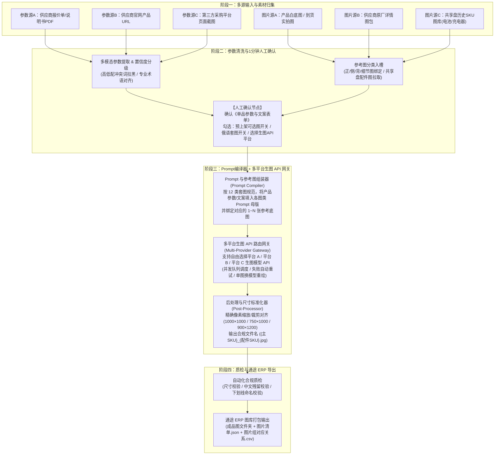

# 批量自动化生图系统：开发需求规格说明书（PRD V2.0 - 多平台生图 API 驱动版）

| 文档版本 | V2.0（生图模型 API 驱动架构） | 适用对象 | 研发部（前后端/AI工程）、产品运营部 |
| :--- | :--- | :--- | :--- |
| **状态** | 已确认套图标准与 API 生图技术路线 | **核心关联规范** | 《批量自动化生图系统：单品标准套图规范（V1.1）》 |

---

## 一、 项目背景与核心技术路线

### 1.1 业务背景与痛点
公司跨境电商（速卖通多店铺、俄语区平台等）新品上架需制作全套合规图片（主图、白底副图、包裹图、多 SKU 属性图、场景图、卖点图、750×1000 广告图、结构图、手持图及俄语套图）。此前人工制作存在以下痛点：
1. **多 SKU 裂变与多店铺防重耗时大**：一个产品含多颜色、多频段（`FCC/LBT`）、多电池套餐时，需产出 30~60 张图，人工机械作图效率低且易出错（如文件名下划线 `_` 写成中横杠 `-`、电池素材贴反）。
2. **供应商原厂图问题多**：原厂图尺寸不统一（多为 `750×1000`）、英文图残留未翻译中文、存在乱码，或混入高配型号参数（如普通版混入 `MAX` / `900MHz`）。
3. **上游输入源杂乱 & 预上架需求**：参数来源涵盖报价单、官网 URL、第三方平台（1688/淘宝）截图；且存在“工厂样品未寄到，店铺需先行预上架”的场景。

### 1.2 核心技术路线（已验证）
经实际平台测试验证：**使用「单张/多张产品白底图或实拍图 + 明确的结构化提示词（Prompt）」，通过调用生图大模型 API（Image-to-Image / 图像编辑与受控生成 API），产出的图片质量已达到直接上架使用的标准。**

因此，本系统无需开发沉重的传统本地 PSD 图层渲染引擎或复杂的像素级局部擦除算法，整体采用**「多源参数提取 → 结构化 Prompt 与参考图动态组装 → 多平台生图 API 自由路由调用 → 尺寸归一化与通途 ERP 打包」**的轻量化架构：
1. **统一采用生图模型 API 驱动**：所有需要生成或重构的套图，均通过向生图 API 传入**「参考底图（白底图 / 实拍图 / 原厂图 / 共享盘配件图）+ 针对该图类定制的结构化 Prompt」**直接生成。
2. **多平台 API 插件化接入与自由切换**：系统设计统一的模型网关适配层（Adapter Pattern），支持接入多个平台的生图 API（具体平台 API 文档后续按需配置接入），运营/使用人员在生图时可**自由选择使用哪个平台、哪个模型**执行批量生图或单图重绘。

### 1.3 明确不纳入范围的图类
1. **额外的 10 张通用英文主图**（直接由生成的“6 张速卖通店铺定向首图”作为产品主图）。
2. **尺寸图**（物理测量边界难统一，暂不纳入自动化套图）。
3. **外包装盒图 / 包装图**（统一剔除不做）。

---

## 二、 系统总体架构与端到端业务流程

---

## 三、 上游输入端：多源参数提取与参考图准备

### 3.1 产品参数三大输入源与风控机制

| 输入源类型 | 输入形态 | 提取方式 | 准确性风控要求 |
| :--- | :--- | :--- | :--- |
| **1. 供应商参数表/报价单/说明书** | Excel / Word / TXT / PDF | 文档解析提取产品标题、SKU 变体表、规格参数表、核心卖点、包装清单；从 PDF 说明书切出接线图与操作步骤图作为参考底图。 | **高低配型号隔离**：若同一份报价单含高低配（如 `GX10` 与 `GX10 MAX`），系统根据本次上架 SKU 自动锁定对应列，并将高配专属词（如 `MAX`, `900MHz`, `AG01`）加入**「Prompt 负向提示词 / 禁用词列表」**，防止模型生成错误参数。 |
| **2. 供应商官网 URL** | 供应商产品页链接 | 自动抓取网页文本参数与高清产品原图。 | 若页面含多子型号，在确认表单中提示运营勾选目标子型号。 |
| **3. 第三方采购平台截图** | 1688/淘宝/同行链接页面截图 | 视觉大模型 OCR 提取参数，并与产品实拍图上的外壳/PCB 丝印文字（如 `915MHz`, `60A`）交叉比对。 | **低置信度标黄确认**：第三方平台参数易出错，提取后在前端表单中**标黄高亮**（若与产品丝印冲突则**标红警告**），必须经人工确认/修改后才可组装进生图 Prompt。 |

### 3.2 参考底图（Reference Images）归集与分类槽位
由于生图 API 依赖“参考图 + 提示词”，系统在生图前需将输入图片归入以下 **5 类标准参考图槽位**：
1. **主品多角度参考图槽**（按颜色区分）：`正面图`、`背面图`、`左侧面图`、`右侧面图`（或 `45°斜视图` / `局部细节图`）。*（支持直接传入实拍原图或白底图）*
2. **基础配件全家福参考图槽**：包含包装清单内所有基础配件的平铺实拍图或原厂配件图。
3. **共享盘捆绑配件参考图槽**：根据输入的捆绑配件 SKU（如电池 `RC4226A`、`RC3473` 或兼容充电器 `RC3410`），自动从共享盘图库检索并挂载对应配件的高清参考图。
4. **原厂详情/卖点参考图槽（可选）**：当供应商提供了原厂卖点图、结构图、手持图或说明书截图（哪怕是中文版或 `750×1000` 尺寸）时，挂载为对应图类的输入参考图，供生图 API 进行跨语种重绘与 `1000×1000` 重构。

---

## 四、 多平台生图 API 网关设计（核心新增模块）

为支持后续灵活接入多个平台的生图 API 并在使用时自由切换，系统后端需实现统一的**「生图模型网关（Image Generation Gateway）」**：

### 4.1 统一调用接口抽象（Adapter Pattern）
所有第三方生图平台适配器均实现以下统一标准输入/输出接口：
- **标准请求体（`ImageGenRequest`）**：
  - `provider_id`：所选平台标识（如 `platform_a`, `platform_b` 等，由前端下拉选择）
  - `model_name`：所选平台下的具体模型名称
  - `reference_images`：参考图列表 `List[ImageBytes / ImageURL]`（支持传入 1 张主参考图，或多图组合如 `[主机图, 捆绑电池图, 店铺边框/LOGO参考图]`）
  - `prompt`：组装完毕的结构化正向提示词（含画面主体描述、背景风格、版式布局指令、需渲染在画面上的精确文字内容）
  - `negative_prompt`：负向提示词/禁止出现项（如 `Chinese characters, watermark, blurry product, deformed text, GX10 MAX, 900MHz`）
  - `target_width` & `target_height`：目标宽高（`1000×1000` / `750×1000` / `900×1200`）
- **尺寸后处理标准化（Resolution Normalizer）**：
  - 不同生图平台的 API 原生支持分辨率不同（例如有的平台支持自定义 `1000×1000`，有的仅支持标准档位 `1024×1024`、`768×1024` 或按比例 `1:1`、`3:4` 输出）。
  - 网关层在收到 API 返回的图片后，自动执行**后处理尺寸对齐**：
    - `1:1` 图类（目标 `1000×1000`）：若 API 返回 `1024×1024` 或 `2048×2048`，自动使用 Lanczos 高清插值无损缩放至精确的 `1000×1000`。
    - `3:4` 图类（广告图 `750×1000` / 俄语图 `900×1200`）：请求 API 的 `3:4` 比例档位（如 `768×1024` 或 `1200×1600`），返回后自动等比缩放并居中对齐至精确的 `750×1000` 或 `900×1200`。

### 4.2 平台选择与交互机制
1. **全局默认平台 + 单类/单图灵活切换**：
   - 运营在发起单品批量生图任务时，可在下拉框中选择本次任务使用的**主生图平台与模型**。
   - 支持在系统后台为不同图类绑定最擅长该风格的默认模型（如擅长文字排版渲染的模型用于主图/卖点图/俄语图，擅长真实光影融合的模型用于场景图/模糊背景图）。
2. **单图一键换模型重绘**：
   - 批量生成预览页中，若运营对某一张图的效果不满意，可点击该图右上角的「换模型/微调提示词重绘」，直接切换另一个平台的 API 重新生成该单张图片。

---

## 五、 12 类标准套图的「参考图 + 提示词（Prompt）组装规范」

系统内置 **12 类图片的标准化 Prompt 母版库**。生图时，系统自动将确认后的产品 JSON 数据注入 Prompt 母版，连同参考图一起发送给所选生图 API：

### 5.1 【必选】通用电商标准套图（7 类必选）

| 序号 | 图类名称 | 数量与尺寸 | 传入 API 的参考图 (`reference_images`) | 发送给生图 API 的结构化 Prompt 组装逻辑（母版规范） |
| :--- | :--- | :--- | :--- | :--- |
| **01** | **主图（速卖通 6 张定向首图）** | **6 张** `1000×1000` | • 第 1~5 张：传入 `[产品正面图]`（及对应店铺边框/水印参考图） • 第 6 张：传入 `[产品侧面图]` | 分别发送 6 条店铺定制 Prompt 请求生图 API： 1. **`9imod` 店铺主图 Prompt**：*"Keep the exact product from the reference image centered. Place it in a realistic {品类关联场景，如 outdoor RC flying field with blue sky} background. Overlay a subtle, semi-transparent '9imod' store name watermark pattern across the background. High-end commercial product photography, 1:1 square."* 2. **`Moonhobby` 店铺主图 Prompt**：*"Keep the exact product from the reference image centered on a clean bright background. Add a bright-colored decorative border frame around the edges featuring the store name 'Moonhobby', and place a badge with the text 'Quality Assurance' in the bottom corner."* 3. **`ROCKET` 全托店首图 Prompt**：*"Extract the exact product from the reference image and place it centered on a pure solid white background (#FFFFFF), occupying 80% of the canvas. Studio lighting, no text, no border, no watermark."* 4. **`9imod` 全托店首图 Prompt**：*"Keep the exact product from the reference image centered on a clean white background. Add a solid red border frame (#E60012) around all four edges of the image featuring the store name '9imod'."* 5. **`SKYRC` 店铺首图 Prompt**：*"Keep the exact front-view product from the reference image in sharp focus. Generate a realistic {桌面/工作台/户外} background with strong Gaussian bokeh blur (shallow depth of field). Real-life photo style, strictly no border frame and no promotional text."* 6. **`FCFT` 店铺首图 Prompt**：*"Keep the exact side-view product from the reference image in sharp focus. Generate a realistic environment background with strong Gaussian bokeh blur. Real-life photo style, strictly no border frame and no promotional text."* |
| **02** | **副图（多角度纯白底图）** | **4 张/色** `1000×1000` | 依次传入该颜色的： 1. `[正面参考图]` 2. `[左侧面/细节图1]` 3. `[右侧面/细节图2]` 4. `[背面参考图]` | • 若输入已是不带杂物的合规白底图，直接标准化居中缩放为 `1000×1000`。 • 若输入为实拍带背景原图，发送白底化 Prompt：*"Keep the exact product from the reference image completely unchanged in shape, color, and printed details. Remove the background and place it centered on a pure white background (#FFFFFF), occupying 80% of the frame, studio lighting, no text, no watermark."* |
| **03** | **包裹图（英文配件清单图）** | **1 张/套餐** `1000×1000` | 传入 `[全套配件实拍图 / 原厂包裹图]` | **Prompt 母版**：*"Create a clean 1:1 white-background e-commerce package contents infographic based on the reference image. Top header text: 'PACKAGE INCLUDES'. Neatly arrange all components in a clean grid layout, and clearly label each item in English below it: {动态注入英文配件清单，如 '1 * GX10 Radio Controller', '1 * Carry Case', ...}. Clean sans-serif typography, no Chinese characters."* |
| **04** | **属性图（SKU 变体组合图）** | **按可售 SKU 数 ($V \times P$ 张)** `1000×1000` | • 单机 SKU：传入 `[对应颜色主机图, 基础配件全家福图]` • 含电池/配件组合 SKU：传入 `[对应颜色主机图, 基础配件图, 共享盘电池/配件参考图]` | **Prompt 母版**：*"Create a 1:1 e-commerce SKU specification image on a white background. Top dark banner displaying bold white text '{产品英文主标题}' on the left, and a bright red badge on the top-right corner with bold white text '{版本标识如 FCC 或 LBT}'. In the main area, prominently display the {颜色英文名} main product on the upper-left, {若含捆绑电池则注入：the bundled battery from the reference image on the upper-right with bold label '{电池规格文字如 18650 Lipo Battery 5550mWh}' kept upright and horizontal}, and arrange all other included accessories in neat rounded-rectangle boxes with English labels at the bottom."* • **输出命名**：强制使用下划线 `{主SKU}_{配件SKU}.jpg`（如 `RC4661A_RC4226A.jpg`）。 |
| **05** | **场景图（装机/真实使用图）** | **1~2 张** `1000×1000` | 传入 `[产品白底/实拍图]` 或 `[原厂场景图]` | **Prompt 母版**：*"Generate a realistic 1:1 in-use scene photo featuring the exact product from the reference image. {根据品类注入真实使用/装机场景描述，如安装在RC车架/穿越机机架上、或连接笔记本电脑FPV模拟器、户外草地操控场景}. Natural lighting, realistic shadows and perspective, non-white background. {若需求要求叠加文字则注入：Overlay title '{场景标题}' and feature badges '{卖点1~4}' cleanly}."*} |
| **06** | **卖点图（核心功能与参数拆解）** | **3~6 张** `1000×1000` | 分别传入： • `[局部特写图 / 原厂卖点底图]` • `[主品图 + 共享盘兼容配件SKU图]` • `[说明书接线图 / 操作步骤截图]` | 按 5 类卖点子版式分别构造 Prompt 调用生图 API（统一输出 `1000×1000`）： 1. **核心硬件/性能卖点 Prompt**：*"Create a 1:1 square commercial feature poster based on the reference image. Highlight the feature with bold English headline '{卖点英文大标题}' and subtitle '{卖点英文描述}'. Replace any Chinese text with English, modern tech style."* 2. **生态兼容/关联配件卖点 Prompt**：*"Create a 1:1 compatibility infographic showing the main product working together with the companion products from the reference images ({关联SKU名称}). Headline: 'Compatible with {兼容型号列表}'."* 3. **接线示意图 (`Diagram`) / 操作步骤图 (`Steps`) Prompt**：*"Redraw/adapt the reference diagram/steps into a clean 1:1 square English infographic. Translate all Chinese labels into accurate RC English terminology: {注入OCR提取并经术语词库校准的中英对照词条}."* 4. **标准规格参数表 (`Specifications`) Prompt（或 HTML 表格直出）**：*"Create a clean 1:1 white-background specification table image titled 'SPECIFICATIONS' at the top, displaying a two-column table with the following exact rows: {注入清洗确认后的 Key-Value 参数表}. Clean typography, no typos."* |
| **07** | **750×1000 广告图** | **1 张** **`750×1000`** | 传入 `[所有颜色变体的正面主图列表]` | **Prompt 母版**：*"Arrange all {C} color variants of the product from the reference images neatly on a pure solid white background (#FFFFFF) in a vertical 3:4 aspect ratio (750x1000). Keep the exact appearance of each color variant, balanced composition filling the frame, strictly no text, no logo, no border."* |

---

### 5.2 【可选】通用电商条件生成套图（2 类可选，适应无样品预上架）

当工厂样品未到且无原厂对应素材时，运营可在确认页取消勾选，系统直接跳过；勾选开启时按以下规范调用生图 API：

| 序号 | 图类名称 | 数量与尺寸 | 传入 API 的参考图 (`reference_images`) | 发送给生图 API 的结构化 Prompt 组装逻辑 |
| :--- | :--- | :--- | :--- | :--- |
| **08** | **【可选】结构图（部件功能引线图）** | **0~2 张** `1000×1000` | 传入 `[原厂结构图（可为中文）]` 或 `[产品正/背面高清图]` | **Prompt 母版**（若正反面复杂则分正面、背面发送 2 次请求）：*"Create a clean 1:1 square product structure and button layout diagram on a white background titled 'BUTTON LAYOUT' based on the reference image. Point callout lines to each part with accurate English labels: {注入经航模术语词典校准的英文部件名列表，如 'IPS Touchscreen', 'Left Gimbal', 'Right Gimbal', 'Power Button', 'USB-C Port', 'Battery Bay', 'BATTERIES NOT INCLUDED'}. Strictly no Chinese characters and no spelling errors."* |
| **09** | **【可选】实拍对比图（手持/体积参照图）** | **0~1 张** `1000×1000` | 传入 `[原厂/实拍手持图]` 或 `[产品正面图]` | **Prompt 母版**：*"Generate a realistic 1:1 close-up photo showing human hands holding the exact product from the reference image (scaled accurately to its real physical size of {长宽高 mm}), demonstrating its real-world size and ergonomic grip. Natural indoor/outdoor background, no promotional text."* |

---

### 5.3 【按需开启】俄语区专属标准套图（尺寸统一 `900 × 1200`）

当开启俄语套图开关时，系统按 `3:4` 竖版比例（目标输出 `900 × 1200`）组装以下俄语专属 Prompt 调用生图 API：

| 序号 | 图类名称 | 数量与尺寸 | 传入 API 的参考图 (`reference_images`) | 发送给生图 API 的结构化 Prompt 组装逻辑 |
| :--- | :--- | :--- | :--- | :--- |
| **10** | **俄语主图 (01~03)** | **3 张 / 主SKU** *(4个主SKU则为12张)* `900×1200` | 传入 `[当前主SKU对应颜色的产品图, 俄语主图01/02/03风格参考样图]` | 遍历每个主 SKU（如 `RC4661A`~`D`），分别结合 3 张俄语样图版式发送 3 条 Prompt： • **俄语主图 01~03 Prompt 母版**：*"Following the blue-and-yellow 9iMOD Russian e-commerce poster layout style from the style reference image (vertical 3:4, 900x1200), place the exact {颜色} product in the foreground. Render bold white headline '{俄语标题，如 GX10 Radio}' and Russian description text '{俄语长文案}' at the top. Display feature badges with exact text: {分别注入主图01/02/03的俄语参数标签及当前SKU的 FCC 或 LBT 标识}. Bottom-right corner shows '9iMOD' logo."* |
| **11** | **俄语包裹图 (Комплектация)** | **1 张 / 颜色套餐** *(如2色×3套餐=6张)* `900×1200` | 传入 `[对应颜色主机+配件图, (可选)捆绑电池参考图, 俄语包裹图风格样图]` | **Prompt 母版**：*"Following the 9iMOD Russian package contents poster layout (vertical 3:4, 900x1200), top blue banner with bold white Russian text 'Пакет включает'. Middle white rounded container displaying all items neatly ({若为含电池套餐则注入：including the bundled 18650 batteries from the reference image}). Bottom grey rounded box listing the Russian package contents in two columns: {注入俄语配件清单文本，含电池套餐末尾追加 '1 × Батарея'}."* |
| **12** | **【可选】俄语详情图** | **按需生成** `900×1200` | 传入 `[已生成的英文卖点图/结构图]` | **Prompt 母版**：*"Adapt the reference infographic into a vertical 3:4 (900x1200) Russian version. Keep the visual graphics identical, and replace all English text with the following Russian translations: {注入俄语卖点/结构词条}."* |

---

## 六、 下游输出端：文件命名与通途 ERP 自动打包

1. **标准文件命名输出**：
   - `主图1.jpg` ~ `主图6.jpg`（对应 6 张速卖通店铺定向首图，`1000×1000`）
   - `zt(1).jpg` ~ `zt(N).jpg`（对应多角度纯白底副图，`1000×1000`）
   - `包裹图.jpg`（英文配件清单图，`1000×1000`）
   - `{主SKU}.jpg` 及 `{主SKU}_{配件SKU}.jpg`（SKU 属性图，**强制下划线连接**，`1000×1000`）
   - `详情图(1).jpg` ~ `详情图(K).jpg`（包含场景图、卖点图、参数表图，以及勾选生成的结构图、手持对比图，全部 `1000×1000`）
   - `750X1000.jpg`（全 SKU 白底合集广告图，`750×1000`）
   - `{主SKU}俄文{1~3}.jpg` 及 `{主SKU}(_{配件SKU})俄文4.jpg`（俄语主图与俄语包裹图，`900×1200`）
2. **通途 ERP 映射文件自动生成（`图片清单.json` & `图片组对应关系.csv`）**：
   - 自动将上述产出图片组装为通途 ERP 所需的 `Group A`（全量图库）、`Group D`（详情图组）、`Group V`（SKU 属性图组）以及 `Group L1~L10`（将 6 张速卖通店铺定向主图分别分配至对应店铺刊登组的首图 `imageType=W`，搭配详情图 `D` 与轮播附图 `E`）。

---

## 七、 后续接入多平台 API 文档的扩展预留说明

当你后续提供各生图平台的 API 接入文档时，开发团队只需在 `Multi-Provider Gateway` 模块中按以下清单配置各平台适配器：
1. **认证与端点配置**：API Base URL、Auth Header / API Key 轮询池、并发 Rate Limit（QPS 限制）。
2. **参考图传参方式映射**：Base64 编码直传 vs 预签名 OSS URL 传参 vs Multipart 表单上传；单图接口 vs 多图参考（Multi-Image Reference）接口映射。
3. **分辨率与宽高比参数映射**：将系统的 3 种标准尺寸（`1000×1000`、`750×1000`、`900×1200`）映射为各平台 API 支持的 `size` 或 `aspect_ratio`（`1:1`、`3:4`）参数，并由网关后处理器统一缩放到精确像素尺寸。

---

## 八、 人机交互界面（UI 定稿基线 V2）

前端界面以 `UI交互界面预览/UI设计规范_V2_定稿.md` 为唯一视觉和框架基准（2026-11-24 已确认），包括左侧导航、页头步骤条、卡片化内容区和底部操作栏的整体框架，以及靛蓝主色、三种状态色和线性图标的视觉基调。

| 步骤 | 页面 | 核心交互 |
|---|---|---|
| ① 导入素材 | `UI_步骤1_素材投递与智能预检.png` | 拖入商品文件夹 → 自动解析需求表和报价单 → 按颜色分组展示可用素材 → 预检 6 项并自动排除低清图和带字图 |
| ② 核对参数 | `UI_步骤2_1分钟参数与图片槽位核对.png` | 勾选出图范围 → 核对品牌 LOGO 开关和标黄的待确认参数 → 检查参考图槽位（可拖拽替换）→ 查看 SKU 组合矩阵 → 选择生图平台和模型 |
| ③ 生成与验收 | `UI_步骤3_批量生图看板与单图重绘.png` | 成品图网格按图类筛选、标出待复核 → 单图检查器对比版本、换参考图、换平台或模型、改提示词重绘 → 导出通途图库包 |

新增页面（工作台、任务列表、品牌 LOGO 库、提示词模板、平台配置）必须沿用这套规范，并先以「文字 + 原型图」的形式给用户确认，再开发。
